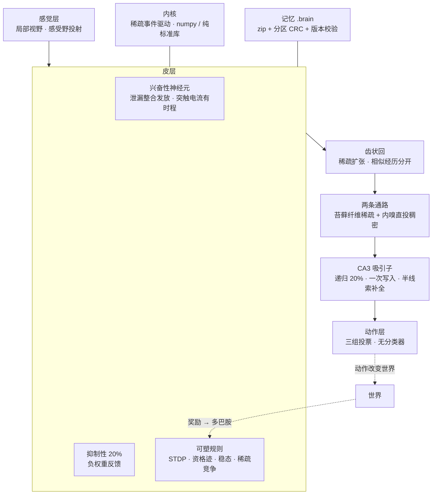

# cerebrum v2

A spiking brain engine. LIF neurons, sparse event-driven wiring, inhibitory
interneurons, a hippocampal attractor, and a memory file you can save, reload,
merge and transplant.

Not a classifier. Not a transformer. No loss function, no backward pass, no
gradient anywhere in the engine. Every mechanism in here changes one thing:
synaptic weight.

```python
from cerebrum.core import Brain
from cerebrum.plasticity import Eligibility, Dopamine
from cerebrum import memory

brain = Brain(neurons=139_000, inputs=363, outputs=3, fan_in=360, seed=1)
brain.add_rule(Eligibility())          # spike timing tags a synapse
brain.add_rule(Dopamine())             # reward cashes the tag in
brain.run(2500)                        # no input: it wakes itself up

action, spikes = brain.step(sensors)   # 363 sensors -> 3 actuators

memory.save(brain, "day1.brain")       # full state, checksummed
same = memory.load("day1.brain")       # bit-identical continuation
```

Runs on the standard library alone. NumPy is used automatically when present.

---

## Architecture



Five layers, one rule: only synaptic weight changes. Nothing outside the
network decides what it does.

**感觉层** — Each sensor drives only a bounded patch of neurons. An unbounded
projection costs `sensors × neurons` synaptic events per step and dominates
everything else: measured, 128 sensors over 1M neurons took 836 ms/step before
this bound, 20 ms after.

**皮层** — Leaky integrate-and-fire neurons with a decaying synaptic current,
not an instantaneous kick. Without that current a spike moves its target by
1/tau_m and is gone before the next one arrives, so nothing can ever hand over
to anything — an attractor becomes impossible.

**抑制性 20%** — A separate inhibitory pool with strictly negative weights,
projecting back onto the excitatory cells. This is not decoration. Without it
the recurrent weights either do nothing or the whole network ignites on one
cue, and there is no way to sit between those.

**可塑规则** — Objects, not a pipeline. `STDP` tags by spike timing,
`Eligibility` tags by co-activity with a decay window, `Dopamine` turns a
reward into a scalar gate, `Sleep` prunes and renormalises, `Structural` grows
and removes synapses. All of them are local; none of them sees an error signal.

**海马** — Dentate expansion separates similar episodes, then CA3 stores them
in recurrent weights. Recall is a settling process: the cue is injected, then
released, and the recurrent weights decide the outcome. It can fail, which is
the difference between a memory and a lookup table.

---

## Five design rules, each learned the hard way

**1. Sparsity is a hard cap, and the rate target has to respect it.**
k-WTA allows at most `wta_k` cells to fire, i.e. `wta_k / n × 1000` Hz. Asking
homeostasis for 20 Hz while the cap sits at 1.44 Hz puts the controller in
permanent error: gain and drive climb to their ceilings and it loses all
authority. Measured, it sat at error 18.7 for 1200 steps with drive pinned and
still rising. The target is now derived from the cap.

**2. Homeostasis runs at its declared time constant.** `tau_homeostasis` was
declared and never used, while the learning rate was hand-set 17× slower than
`1/tau`. A silent network therefore needed thousands of steps to reach its
target and looked unable to self-stabilise. It now uses `1/tau`.

**3. Inhibitory weights must be strictly negative.** Drawing them from a
zero-mean normal and negating gives half of them an excitatory sign. Measured,
raising the inhibitory gain from 2.4 to 12 made the network *more* active.

**4. Inhibitory convergence must not scale with the pool.** At 4000 cells the
pool is 800 wide; a fan-in of `n_inhib/2` gave every excitatory cell 400
inhibitory synapses against 200 at 2000 cells, and completion fell from 0.99 to
0.43 — even from a *complete* cue.

**5. Scale down by functional quantity, not by ratio.** The rat CA3 has a 2%
contact probability and each episode cell receives ~60 same-episode inputs.
Copy the 2% into a 2000-cell network and each cell gets 0.8 — completion is
impossible. Keep the 60 (equivalent here to ~20) and it works at 20% density.
**The ratio was never the point; the number of same-episode inputs was.**

---

## Measured

Sparse network, NumPy backend, one process, 16-core desktop, 15.4 GB RAM.

**Throughput**

| neurons | synapses | ms/step | RSS | note |
|---:|---:|---:|---:|---|
| 10 000 | 200 000 | 0.09 | 40 MB | |
| 100 000 | 2 000 000 | 2.71 | 70 MB | |
| **139 000** | **50 000 000** | **17.1** | **1.19 GB** | fly scale, 360 synapses/cell |
| 1 000 000 | 20 000 000 | 38.2 | 366 MB | 20 synapses/cell |

**Hippocampal attractor** (4000 cells, 800 recurrent inputs, 120 cells/episode)

| condition | complete cue | half cue |
|---|---:|---:|
| CA3 alone | 100% | **100%** |
| through dentate + projection | 44% | 13% |

The second row is the current weak link and is not hidden: the projection layer
throws away half the code before CA3 sees it.

**Attractor signature** — ltp 0.10 → 0%, 0.15 → 88% (precision 100%), 0.25 →
network ignites. Cue at 10–30% → 0%, 50% → 88%, 80% → 100%. A random cue
activates **0** cells. A lookup table cannot produce that curve.

**Capacity** — 20 episodes reliable at 4000 cells, collapse at 30.

**MNIST** — 92.3% on 1000 held-out digits after one pass over 20000, against
83.3% for the same linear readout on raw pixels. The spiking features add
~9 points of separability.

**Foraging** — eligibility + dopamine raises food collected by 27% over a
non-learning control. This is the honest number for a purely local rule; an
earlier version using policy gradients scored +100% and was thrown away because
it was not a neuron.

---

## What does not work yet

- **Sleep replay does not consolidate.** Replaying 0, 24 or 96 episodes moves
  representation separability by 0.01 — the numbers are indistinguishable.
- **The hippocampal projection layer loses half the code.** CA3 completes 100%
  of half cues on its own codes, but only 13% once the dentate has re-encoded
  them.
- **No behaviour emerges from the snake task yet.** A non-learning brain alive
  for 60 episodes collects 0.12 food on average, and its action distribution is
  already biased (68% straight) purely from initial wiring — so "low entropy"
  is not evidence of learning.
- **Eligibility costs ~2× per step at fly scale**, because the trace array over
  50M synapses is decayed in full every step.

---

## Usage

No install step — this is a runnable project, not a package to depend on.
Clone it and run modules from the repository root.

```bash
# scale benchmark
python -m cerebrum.bench.scale

# tests
python -m unittest discover -s cerebrum/tests -t .

# MNIST
python -m cerebrum.examples.mnist_digits --neurons 2000 --per-class 2000

# snake, with a recording you can replay in a browser
python -m cerebrum.experiments.snake_run --episodes 60 --record --out data/run.json
python -m cerebrum.experiments.make_player --record data/run.json --out player.html
```

## Modules

| file | what |
|---|---|
| `core.py` | `Brain`: assembly, sensors/actuators, rules, sleep, experience |
| `ca3.py` | spiking recurrent attractor with an inhibitory pool |
| `hippocampus.py` | dentate expansion, mossy + direct projections, episodes |
| `plasticity.py` | STDP · Eligibility · Dopamine · Sleep · Pruning · Structural |
| `memory.py` | `.brain` format: save, load, merge, graft |
| `snake.py` / `world.py` / `agent.py` | closed loops to test behaviour in |
| `backends/` | `numpy` (fast) and `pure` (standard library only) |

## The `.brain` format

A ZIP of little-endian arrays plus a JSON manifest. Every part carries a
CRC32; the format version is checked on load; nothing is ever unpickled, so a
file cannot execute code.

| part | content |
|---|---|
| `manifest.json` | version, architecture signature, rule specs, scalars |
| `connectome.bin` `sensor.bin` | sparse weights, CSR |
| `neurons.bin` | membrane, threshold, adaptation, refractory, resources |
| `dentate.bin` `episodes.bin` | hippocampal codes and the events themselves |

Saved and reloaded state continues bit-identically — verified over 1000 steps
with plasticity enabled.

## License

MIT.
