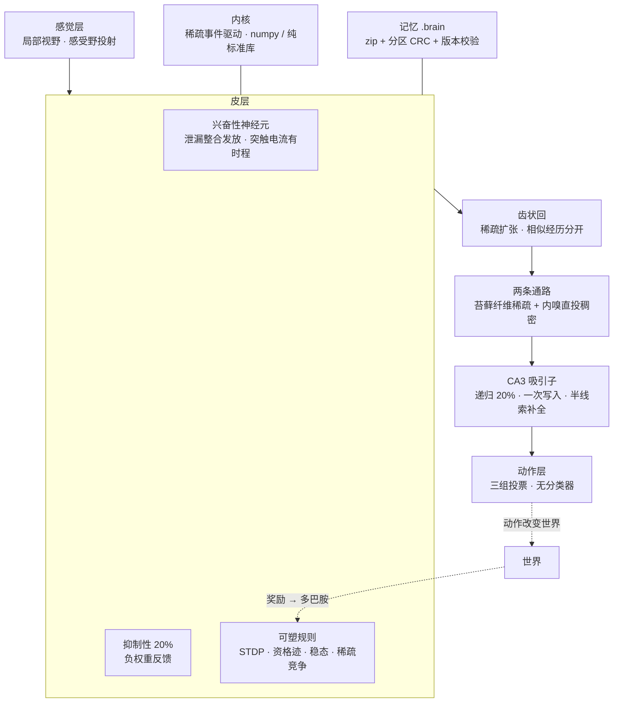

# cerebrum v2

A spiking brain engine, and — in `cerebrum.brain` — an assembled one: neuron
sheets with positions, a thalamic gate, a three-layer cortex that forms its own
maps, basal ganglia that pick an action, a hippocampus that completes a
partial memory, an amygdala that learns fear in one trial, a cerebellum that
learns timing from error, a hypothalamus that supplies the drives, and five
neuromodulators that change how the rest computes.

LIF neurons, sparse event-driven wiring, inhibitory interneurons, and a memory
file you can save, reload, merge and transplant.

Not a classifier. Not a transformer. No loss function, no backward pass, no
gradient anywhere in the engine. Every mechanism in here changes one thing:
synaptic weight.

```python
from cerebrum.core import Brain
from cerebrum.plasticity import Eligibility, Dopamine
from cerebrum import memory

brain = Brain(neurons=139_000, inputs=363, outputs=3, fan_in=360, seed=1)
brain.add_rule(Eligibility())          # spike timing tags a synapse
brain.add_rule(Dopamine())             # reward cashes the tag in
brain.run(2500)                        # no input: it wakes itself up

action, spikes = brain.step(sensors)   # 363 sensors -> 3 actuators

memory.save(brain, "day1.brain")       # full state, checksummed
same = memory.load("day1.brain")       # bit-identical continuation
```

Runs on the standard library alone. NumPy is used automatically when present.

---

## The whole brain

Everything above is a substrate: one population, one wiring scheme, one output
readout. It can be driven, it can learn, and it cannot decide anything, because
a brain that is one homogeneous sheet has nowhere for a decision to happen.

`cerebrum.brain` is the assembled organ set. Each anatomical system is a
separate module with its own cells, its own dynamics and its own job, wired
into the loops that make behaviour possible.

```python
from cerebrum.brain import WholeBrain, Body

brain, body = WholeBrain(seed=0), Body(seed=0)
sensors = body.reset()
for _ in range(10_000):
    out = brain.step(sensors, us=1.0 if body.fear > 0.85 else 0.0)
    sensors, reward, done, info = body.act(out["action"])
    if reward:
        brain.reinforce(reward)          # dopamine = reward - prediction
    if done:
        sensors = body.reset()
```

| System | Module | Level | What it does |
|---|---|---|---|
| Neuron sheet | `sheet` | spiking | 2-D positions, distance-decayed E/I wiring, divisive inhibition, multiplicative homeostasis |
| Thalamus | `thalamus` | spiking | relay + reticular gate; the cortex suppresses what it is not tracking |
| Cortex | `cortex` | spiking | L4 → L2/3 → L5, self-organising thalamocortical map, prefrontal working memory |
| Basal ganglia | `basal_ganglia` | rate | D1/D2/GPe/STN/GPi, action selection by disinhibition |
| Hippocampus | `hippocampus` | hybrid | EC → DG → CA3 → CA1, one-shot storage, pattern completion, reinstatement |
| Amygdala | `amygdala` | spiking | LA/BLA/CE, one-trial fear conditioning gated by arousal |
| Hypothalamus | `hypothalamus` | rate | hunger, fatigue, fear, orexin — the drives that give behaviour a reason |
| Cerebellum | `cerebellum` | spiking | granule → Purkinje → deep nuclei, timing learned by climbing-fibre LTD |
| Neuromodulators | `neuromodulation` | scalar | dopamine, serotonin, noradrenaline, acetylcholine, orexin |

The level of description differs by system on purpose and every module says so
in its own docstring. Selection, drive and concentration are settling
processes and slow variables; modelling them as spikes costs time and adds no
mechanism. The sheets, thalamus, amygdala, hippocampus and cerebellum are
spiking.

### What each system is for, and how you can tell

Every claim below comes from an ablation in `cerebrum.brain.protocols`: the
same seed, one mechanism switched off, everything else identical.

| Claim | Control | Intact |
|---|---|---|
| Cortex partitions itself into areas without being told where | 0.499 adjacency, 144 fragments (winner-only learning) | **0.956 adjacency, 5 territories** (with a neighbourhood) |
| The thalamus gates what the cortex ignores | 100% of the distractor relay survives with the reticular nucleus lesioned | **57% survives**; the attended channel keeps 100% |
| The basal ganglia pick one action | 6 channels open, strongest proposal chosen 13% of the time (chance) | **1 channel open, chosen 100%** |
| The hippocampus completes a partial cue | 0.22 Jaccard with no storage | **0.69 Jaccard** after one exposure each |
| The amygdala learns fear in one trial | 0.00 with arousal blocked | **1.43 to the paired cue, 0.00 to an unpaired one** |
| The cerebellum learns timing from error | Purkinje response 0.99 with LTD disabled | **0.72 with LTD** — the trained response is suppressed |
| Dopamine codes prediction error, not reward | — | **1.00 → 0.68** as the reward becomes predicted, **−0.33 on omission** |

### The finding that made the architecture possible

The previous generation could not self-organise, and the reason was not the
learning rule. It was that its neurons had no positions.

Measured on an 800-neuron flat population with competitive input learning:
adjacent neurons agreed on their preferred stimulus 51% of the time against a
50% chance baseline. Preferences were scattered noise, and no learning rule
could have fixed it, because "adjacent" had no meaning.

Give the same cells coordinates, distance-decayed wiring, local inhibition and
a neighbourhood kernel, and the same competitive rule produces territories:

```
sigma = 0.00 (winner only)   adjacency 0.499   144 fragments
sigma = 0.25 (neighbourhood) adjacency 0.956     5 fragments
```

No region borders were specified anywhere. The areas are a consequence of the
geometry, which is also why they cannot appear without it.

### Where the assembled brain actually stands

It runs a closed loop at about 3 ms per millisecond of simulated time, all
systems engaged, no numerical blow-ups over tens of thousands of steps. On the
foraging task it eats, avoids the predator some of the time, and rests when
tired.

It is not competent. At these timescales — tens of seconds of simulated life —
the cortex's synapses have barely moved, so most of what it does is reflex:
thalamic relay, hypothalamic drive, basal ganglia gating. Learning is present
and measurable in the subsystems; it has not yet had time to show up as
skilled behaviour. That is the honest state of it.

---

## The substrate engine

The original engine — `cerebrum.core.Brain` — is still here and still what the
scale benchmarks measure. It is one population with one wiring scheme and one
readout: useful as a substrate, insufficient as a brain.



Five layers, one rule: only synaptic weight changes. Nothing outside the
network decides what it does.

**感觉层** — Each sensor drives only a bounded patch of neurons. An unbounded
projection costs `sensors × neurons` synaptic events per step and dominates
everything else: measured, 128 sensors over 1M neurons took 836 ms/step before
this bound, 20 ms after.

**皮层** — Leaky integrate-and-fire neurons with a decaying synaptic current,
not an instantaneous kick. Without that current a spike moves its target by
1/tau_m and is gone before the next one arrives, so nothing can ever hand over
to anything — an attractor becomes impossible.

**抑制性 20%** — A separate inhibitory pool with strictly negative weights,
projecting back onto the excitatory cells. This is not decoration. Without it
the recurrent weights either do nothing or the whole network ignites on one
cue, and there is no way to sit between those.

**可塑规则** — Objects, not a pipeline. `STDP` tags by spike timing,
`Eligibility` tags by co-activity with a decay window, `Dopamine` turns a
reward into a scalar gate, `Sleep` prunes and renormalises, `Structural` grows
and removes synapses. All of them are local; none of them sees an error signal.

**海马** — Dentate expansion separates similar episodes, then CA3 stores them
in recurrent weights. Recall is a settling process: the cue is injected, then
released, and the recurrent weights decide the outcome. It can fail, which is
the difference between a memory and a lookup table.

---

## Five design rules, each learned the hard way

**1. Sparsity is a hard cap, and the rate target has to respect it.**
k-WTA allows at most `wta_k` cells to fire, i.e. `wta_k / n × 1000` Hz. Asking
homeostasis for 20 Hz while the cap sits at 1.44 Hz puts the controller in
permanent error: gain and drive climb to their ceilings and it loses all
authority. Measured, it sat at error 18.7 for 1200 steps with drive pinned and
still rising. The target is now derived from the cap.

**2. Homeostasis runs at its declared time constant.** `tau_homeostasis` was
declared and never used, while the learning rate was hand-set 17× slower than
`1/tau`. A silent network therefore needed thousands of steps to reach its
target and looked unable to self-stabilise. It now uses `1/tau`.

**3. Inhibitory weights must be strictly negative.** Drawing them from a
zero-mean normal and negating gives half of them an excitatory sign. Measured,
raising the inhibitory gain from 2.4 to 12 made the network *more* active.

**4. Inhibitory convergence must not scale with the pool.** At 4000 cells the
pool is 800 wide; a fan-in of `n_inhib/2` gave every excitatory cell 400
inhibitory synapses against 200 at 2000 cells, and completion fell from 0.99 to
0.43 — even from a *complete* cue.

**5. Scale down by functional quantity, not by ratio.** The rat CA3 has a 2%
contact probability and each episode cell receives ~60 same-episode inputs.
Copy the 2% into a 2000-cell network and each cell gets 0.8 — completion is
impossible. Keep the 60 (equivalent here to ~20) and it works at 20% density.
**The ratio was never the point; the number of same-episode inputs was.**

---

## Measured

Sparse network, NumPy backend, one process, 16-core desktop, 15.4 GB RAM.

**Throughput**

| neurons | synapses | ms/step | RSS | note |
|---:|---:|---:|---:|---|
| 10 000 | 200 000 | 0.09 | 40 MB | |
| 100 000 | 2 000 000 | 2.71 | 70 MB | |
| **139 000** | **50 000 000** | **17.1** | **1.19 GB** | fly scale, 360 synapses/cell |
| 1 000 000 | 20 000 000 | 38.2 | 366 MB | 20 synapses/cell |

**Hippocampal attractor** (4000 cells, 800 recurrent inputs, 120 cells/episode)

| condition | complete cue | half cue |
|---|---:|---:|
| CA3 alone | 100% | **100%** |
| through dentate + projection | 44% | 13% |

The second row is the current weak link and is not hidden: the projection layer
throws away half the code before CA3 sees it.

**Attractor signature** — ltp 0.10 → 0%, 0.15 → 88% (precision 100%), 0.25 →
network ignites. Cue at 10–30% → 0%, 50% → 88%, 80% → 100%. A random cue
activates **0** cells. A lookup table cannot produce that curve.

**Capacity** — 20 episodes reliable at 4000 cells, collapse at 30.

**MNIST** — 92.3% on 1000 held-out digits after one pass over 20000, against
83.3% for the same linear readout on raw pixels. The spiking features add
~9 points of separability.

**Foraging** — eligibility + dopamine raises food collected by 27% over a
non-learning control. This is the honest number for a purely local rule; an
earlier version using policy gradients scored +100% and was thrown away because
it was not a neuron.

---

### Six more rules, each learned by watching something fail

Building the organ set produced its own catalogue of mistakes. They are here
because every one of them cost a day and none of them is in a textbook.

**1. Membrane noise is not decoration.** A deterministic LIF threshold is a
step function: a cell's rate jumps from 0 to 80 Hz as its input crosses
threshold, so no homeostatic controller can hold it at a target. Every sheet
pinned its gain at the ceiling and went permanently silent. Adding noise
(σ = 0.045) turns the step into a sigmoid, and the f-I curve becomes something
a controller can work with — 2.9 Hz at zero input, 45 Hz at six.

**2. Homeostasis has to be multiplicative.** An integrating threshold
controller overshoots, saturates at its cap, and then has to unwind. Measured,
L2/3 oscillated between 5 and 60 spikes per step with a period near 600 ms,
indefinitely. A gain controller — `g *= exp(-eta * (rate/target - 1))` —
reduces error geometrically and cannot wind up.

**3. Inhibitory cells must actually inhibit.** The weight builder assigned a
positive magnitude to every synapse and used the presynaptic cell type only to
decide *which* magnitude. Result: every interneuron in every sheet was
excitatory. The network still ran, which is exactly why it took so long to
find.

**4. Afferents obey Dale's law too.** Thalamocortical weights were drawn with
random signs, so half the projection from the thalamus was inhibitory and
cancelled the input. L4 sat at zero spikes per step while L2/3 downstream was
firing: the input layer was being suppressed by its own input.

**5. Shunting inhibition divides; it does not subtract.** Implemented as
current, the relay's homeostatic gain compensated it away and the gate ran
backwards — attending a channel made it eight times louder. Implemented as a
divisor on the relay's output, a channel the cortex targets drops to 57%.

**6. An attractor needs de-meaned weights.** With `W = Σ c cᵀ`, cells that
appear in many episodes accumulate weight to everything and every cue collapses
onto them: completion was a flat 0.27 no matter how much of the cue was
present. Subtracting the mean activity before the outer product — the
covariance rule — takes the same network to 0.98.

## What does not work yet

- **Sleep replay does not consolidate.** Replaying 0, 24 or 96 episodes moves
  representation separability by 0.01 — the numbers are indistinguishable.
- **The hippocampal projection layer loses half the code.** CA3 completes 100%
  of half cues on its own codes, but only 13% once the dentate has re-encoded
  them.
- **No behaviour emerges from the snake task yet.** A non-learning brain alive
  for 60 episodes collects 0.12 food on average, and its action distribution is
  already biased (68% straight) purely from initial wiring — so "low entropy"
  is not evidence of learning.
- **Eligibility costs ~2× per step at fly scale**, because the trace array over
  50M synapses is decayed in full every step.

For the assembled brain:

- **Pattern completion stops working below ~70% of the cue.** At 70% of the
  input the cortex still reinstates the stored episode (0.97 Jaccard); at 50%
  it drops to 0.44. The entorhinal re-coding separates a degraded cue into a
  different code before CA3 ever sees it. Separation and completion pull
  against each other, and the crossover is measurable.
- **Behaviour is reflexive, not competent.** Over 8,000 steps the animal eats
  and sometimes evades, but the actions track thalamic relay and hypothalamic
  drive more than they track anything learned: cortical synapses have moved
  almost nothing in 8 seconds of simulated life.
- **The lesion suite cannot yet resolve most systems.** Of seven lesions, only
  the thalamus produces a difference outside the noise at this timescale
  (eating drops from 17 to 5). The others are real bypasses — verified by unit
  tests — but 8,000 ms is too short for their contribution to show up in
  behaviour.
- **High tonic dopamine disinhibits everything.** With dopamine near +1 every
  channel releases at once, which is a plausible model of the failure mode but
  is currently unregulated rather than a designed feature.

---

## Usage

No install step — this is a runnable project, not a package to depend on.
Clone it and run modules from the repository root.

```bash
# scale benchmark
python -m cerebrum.bench.scale

# tests
python -m pytest tests -q

# every ablation, one after another (takes a few minutes)
python -m cerebrum.brain.protocols

# one experiment
python -m cerebrum.brain.protocols pattern_completion
python -m cerebrum.brain.protocols lesions

# MNIST
python -m cerebrum.examples.mnist_digits --neurons 2000 --per-class 2000

# snake, with a recording you can replay in a browser
python -m cerebrum.experiments.snake_run --episodes 60 --record --out data/run.json
python -m cerebrum.experiments.make_player --record data/run.json --out player.html
```

## Modules

| file | what |
|---|---|
| `core.py` | `Brain`: assembly, sensors/actuators, rules, sleep, experience |
| `ca3.py` | spiking recurrent attractor with an inhibitory pool |
| `hippocampus.py` | dentate expansion, mossy + direct projections, episodes |
| `plasticity.py` | STDP · Eligibility · Dopamine · Sleep · Pruning · Structural |
| `memory.py` | `.brain` format: save, load, merge, graft |
| `snake.py` / `world.py` / `agent.py` | closed loops to test behaviour in |
| `backends/` | `numpy` (fast) and `pure` (standard library only) |
| `brain/sheet.py` | two-dimensional neuron sheet: positions, local E/I, divisive inhibition, multiplicative homeostasis |
| `brain/thalamus.py` | relay nucleus + reticular gate |
| `brain/cortex.py` | L4 / L2-3 / L5, self-organising map, prefrontal attractor |
| `brain/basal_ganglia.py` | direct / indirect pathways, action selection |
| `brain/hippocampus.py` | EC / DG / CA3 / CA1 with cortical reinstatement |
| `brain/amygdala.py` | one-trial fear conditioning |
| `brain/hypothalamus.py` | homeostatic drives |
| `brain/cerebellum.py` | granule / Purkinje / deep nuclei, LTD |
| `brain/neuromodulation.py` | five slow modulators |
| `brain/body.py` | grid world with food and a predator |
| `brain/whole_brain.py` | the assembly, with lesion support |
| `brain/protocols.py` | the ablation experiments |

## The `.brain` format

A ZIP of little-endian arrays plus a JSON manifest. Every part carries a
CRC32; the format version is checked on load; nothing is ever unpickled, so a
file cannot execute code.

| part | content |
|---|---|
| `manifest.json` | version, architecture signature, rule specs, scalars |
| `connectome.bin` `sensor.bin` | sparse weights, CSR |
| `neurons.bin` | membrane, threshold, adaptation, refractory, resources |
| `dentate.bin` `episodes.bin` | hippocampal codes and the events themselves |

Saved and reloaded state continues bit-identically — verified over 1000 steps
with plasticity enabled.

## License

MIT.
